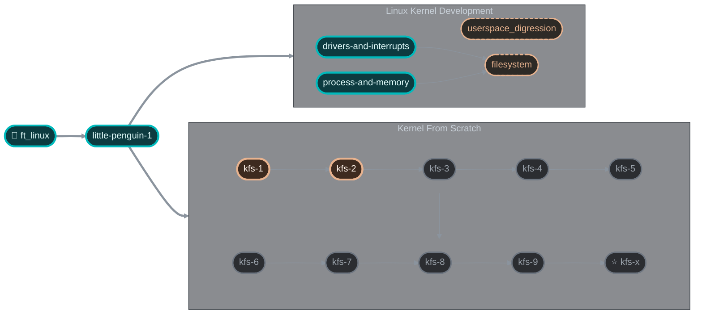

# 42 Kernel Track

Monorepo for the **Kernel** branch of the 42 cursus (42 Lausanne) — from building a Linux distribution by hand, through Linux kernel module development, to writing an operating system kernel from scratch.

Each project lives in its own directory and has its own `README.md` / `PLAN.md` with details.

## Track map



<sub>🟦 Done &nbsp;·&nbsp; 🟧 In progress &nbsp;·&nbsp; ⬜ Locked &nbsp;·&nbsp; dashed — available</sub>

## Projects

### Linux

| Project | Topic | Status |
|---------|-------|--------|
| [ft_linux](./ft_linux) | Custom Linux distribution built from source (Linux From Scratch) | Done |
| [little-penguin-1](./little-penguin-1) | Introduction to Linux kernel development: kernel builds, modules, patches, debugfs | Done |
| drivers-and-interrupts | Keyboard driver as a kernel module, interrupt handling | — |
| process-and-memory | Custom syscall exposing process and memory information | — |
| filesystem | Filesystem implementation as a kernel module | — |
| userspace_digression | Userspace side of the kernel track | — |

### Kernel From Scratch (KFS)

An i386 kernel written in C and assembly, booted by GRUB and run in QEMU.

| Project | Topic | Status |
|---------|-------|--------|
| [kfs-1](./kfs-1) | Multiboot, GRUB, VGA text mode, basic kernel library | In progress |
| [kfs-2](./kfs-2) | Global Descriptor Table, kernel stack, debug shell | In progress |
| kfs-3 | Memory: paging, physical and virtual allocators | — |
| kfs-4 | Interrupts: IDT, signals, keyboard | — |
| kfs-5 | Processes: scheduling, `fork`, `wait`, `exit` | — |
| kfs-6 | Filesystem: IDE driver, ext2 | — |
| kfs-7 | Syscalls, sockets, environment | — |
| kfs-8 | Kernel modules | — |
| kfs-9 | ELF loading and execution | — |
| kfs-x | Complete POSIX-compliant UNIX system | — |

## Repository layout

```
.
├── ft_linux/            # LFS build scripts, configs, docs
├── little-penguin-1/    # Kernel assignments 00–09
├── kfs-1/               # KFS: boot + screen
├── kfs-2/               # KFS: GDT + stack
└── ...                  # Next projects are added as separate directories
```
